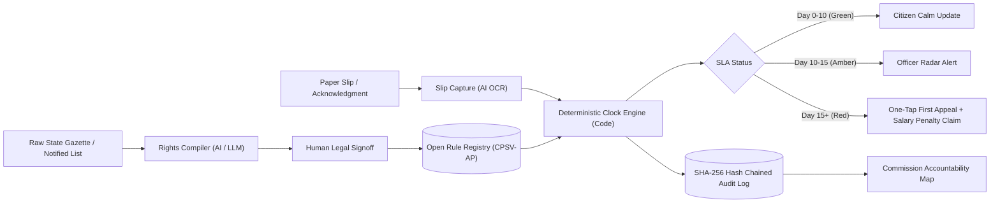

# SAMAY — UPI for Service Promises
> **Every deadline a state promised, enforced by default.**  
> *“The law promised her 15 days. Nobody told her she could appeal.”*  
> **Build for Bharat 2026 | Track 1 Software | PS 3 Open Innovation**  
> **Team Gryffindor:** Divyank Richhariya | Deepika Kumari | Anushka Yadav | Athar Yadav

---

## 📌 Executive Summary / Abstract

About 30 Indian states have **Right to Public Services (RTS) laws** that legally promise time-bound public services (e.g., *Maharashtra Right to Public Services Act 2015*, *Karnataka Sakala Act 2011*), with statutory penalties for officer delay.

Enforcement still relies on the citizen, who must notice the delay, know the law, find the First Appellate Authority (FAA), draft an appeal, and track hearing dates. A CAG audit of Maharashtra (Report No. 1 of 2023) revealed:
- **2.12 Crore** applications decided after statutory deadlines (28.14% of decided applications from 2016 to 2021).
- **32.85 Lakh** applications still pending beyond SLA.
- **63%** of surveyed citizens did not know their legal right to appeal.
- **89%** of applications originate on paper or at physical Seva Kendras / CSC kiosks, completely untracked by legal clocks.

**SAMAY turns these statutory promises into code.**  
Just as **UPI standardised the payment protocol and not an individual bank**, **SAMAY standardises the service promise layer across all Indian states**. It moves the burden of enforcing a right from the citizen to the system.

---

## 🏛️ Core Architectural Innovations



### 1. Rights Compiler (LLM-Assisted, Human-in-the-Loop)
- Ingests raw public notices, gazettes, and government notifications (multilingual: English, Marathi, Kannada, Hindi).
- Compiles unstructured text into an open, machine-readable **CPSV-AP-inspired JSON schema**:
  - `service_id`, `service_name`, `department`, `deadline_days`, `deadline_type`, `designated_officer`, `first_appellate_authority`, `penalty_per_day`, `max_penalty`, `appeal_statute_section`.
- **Human-in-the-loop guarantee:** Every rule requires verification and SHA-256 hash signing before committing to the registry.

### 2. Slip Capture (AI OCR for Paper Applications)
- 89% of citizens apply via Seva Kendras, CSCs, or taluk offices and receive a paper receipt.
- Helper or citizen snaps a photo of the slip.
- AI extracts: Application ID, Citizen Name, Service Name, Submission Date, District, and Issuing Authority.

### 3. Deterministic Legal Clock Engine (Pure Code, Never an LLM)
- **As Slide 4 mandates: *“The deadline is computed by code, never by an LLM.”***
- Computes working days excluding:
  - All Sundays.
  - 2nd and 4th Saturdays (standard Indian state administrative off days).
  - Official state gazetted holidays (e.g., Chhatrapati Shivaji Maharaj Jayanti, Maharashtra Day, Basava Jayanti, Ambedkar Jayanti).
  - **Statutory Pauses:** If the officer raises a legitimate document defect query, the legal clock pauses deterministically and resumes upon citizen response.
- Computes dynamic status:
  - 🟢 **Day 0–10 (On Time):** Within safe SLA limits.
  - 🟡 **Day 10–15 (At Risk):** ≥ 70% of SLA elapsed; triggers officer radar warning.
  - 🔴 **Day 15+ (Breached):** Statutory deadline breached; unlocks One-Tap First Appeal and accumulates statutory daily penalty (`₹250/day` in MH, `₹20/day` in KA).

### 4. Officer Radar (Departmental Triage)
- Real-time queue for Designated Officers (e.g., Nayab Tahsildar, Tahsildar, SDO).
- Visual warning before deadlines breach to protect officers from personal salary penalties.
- One-click actions: "Issue Certificate", "Raise Query (Pauses Clock)", "Resume Clock".

### 5. One-Tap First Appeal Drafter
- At breach, synthesizes a legally binding **Statutory Form 1 First Appeal** under **Section 18 of Maharashtra RTS Act 2015** or **Section 8 of Karnataka Sakala Act 2011**.
- Pre-addressed to the exact First Appellate Authority (e.g. SDO).
- Includes statutory prayer for:
  1. Delivery of service within 48 hours.
  2. Recovery of accrued statutory penalty from the default officer's monthly salary.
  3. Disciplinary entry in the officer's Annual Confidential Report (ACR).

### 6. Commission Accountability Map & Dashboard
- State RTS Commission heatmap across 36 districts of Maharashtra and 31 districts of Karnataka.
- Live CAG audit comparison tracking late disposal rates, pending backlogs, and total statutory penalties accrued.

### 7. Cryptographic Hash-Chained Audit Log
- Genesis block linked to state RTS framework.
- Every slip registration, clock tick, pause, breach, and appeal submission generates a block chained via SHA-256:  
  `Hash = SHA-256(index + timestamp + previousHash + eventType + payload)`
- Provides tamper-proof verification for the State RTS Commission.

---

## 🛠️ Tech Stack

| Layer | Technology |
|---|---|
| **Frontend** | React 18, Vite, Tailwind CSS, Lucide Icons, Canvas Confetti (PWA-ready) |
| **Backend** | Node.js, Express, CORS, Dotenv, Crypto |
| **Clock Engine** | Deterministic business day & gazetted holiday calculator |
| **AI / LLM** | Google Gemini API (with 100% offline-resilient heuristic fallback) |
| **Data / Schema** | Open CPSV-AP-inspired JSON schema, SHA-256 Hash Chain |

---

## 🚀 Quick Start Guide

### Prerequisites
- Node.js (v18+) and npm installed.

### 1. Installation
```bash
cd samay
npm install
```

### 2. Run the Development Server
```bash
npm run dev
```
Open your browser at **`http://localhost:5173`**.

### 3. Run the Production Full-Stack Server
```bash
npm run build
npm start
```
The full application (frontend + REST API) will be running at **`http://localhost:3001`**.

---

## 🧪 Interactive Hackathon Demo Highlights

1. **Slide 2 Case Study (Farmer's Daughter):**
   - Click **"MahaOnline Income Certificate"** in the preset slips.
   - See the circular clock gauge immediately flag **Day 19 / 15 (Breached by 4 days)**.
   - Statutory penalty accrued: **₹1,000** (at ₹250/day).
   - Click 🚨 **"One-Tap First Appeal"** to preview the pre-addressed Form 1 appeal to the SDO with confetti celebration upon transmission!

2. **Time-Warp Simulator (+5 Days):**
   - Click the **"+5 Days"** button on any application card to watch an on-track application dynamically shift from Green (On Time) ➔ Amber (At Risk) ➔ Red (Breached)!

3. **Officer Radar Triage:**
   - Switch to the **Officer Radar** tab.
   - Click **"Raise Query (Pause)"** on an active application to see the legal clock pause deterministically with reason code.
   - Click **"Resume Clock"** to see it resume.

4. **Live Addition of 3rd State (Delhi e-SLA):**
   - Switch to **Rights Compiler**.
   - Select **"Delhi e-SLA Gazette"** preset.
   - Click **"Compile to Schema with AI"** to see the open CPSV-AP record generated.
   - Click **"Approve & Sign Rule to Registry"** to witness live cross-state scaling!

5. **Tamper-Proof Audit Chain:**
   - Click the **"Blks"** badge in the header.
   - Click **"Verify Chain Integrity"** to verify cryptographic SHA-256 proof across all blocks.
