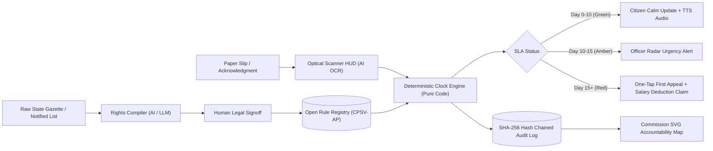

# SAMAY — UPI for Service Promises
> **Every deadline a state promised, enforced by default.**  
> *“The law promised her 15 days. Nobody told her she could appeal.”*  
> **Build for Bharat 2026 | Track 1 Software | PS 3 Open Innovation**  
> **Team Gryffindor:** Divyank Richhariya | Deepika Kumari | Anushka Yadav | Athar Yadav

---

## 📌 Executive Summary / Abstract

About 30 Indian states have **Right to Public Services (RTS) laws** that legally promise time-bound public services (e.g., *Maharashtra Right to Public Services Act 2015*, *Karnataka Sakala Act 2011*), with statutory penalties for officer delay.

Enforcement still relies on the citizen, who must notice the delay, know the law, find the First Appellate Authority (FAA), draft an appeal, and track hearing dates. A CAG audit of Maharashtra (Report No. 1 of 2023) revealed:
- **2.12 Crore** applications decided after statutory deadlines (28.14% of decided applications from 2016 to 2021).
- **32.85 Lakh** applications still pending beyond SLA.
- **63%** of surveyed citizens did not know their legal right to appeal.
- **89%** of applications originate on paper or at physical Seva Kendras / CSC kiosks, completely untracked by legal clocks.

**SAMAY turns these statutory promises into code.**  
Just as **UPI standardised the payment protocol and not an individual bank**, **SAMAY standardises the service promise layer across all Indian states**. It moves the burden of enforcing a right from the citizen to the system.

---

## 🏛️ Core Architectural Innovations



### 1. Rights Compiler (LLM-Assisted, Human-in-the-Loop)
- Ingests raw public notices, gazettes, and government notifications (multilingual: English, Marathi, Kannada, Hindi).
- Compiles unstructured text into an open, machine-readable **CPSV-AP-inspired JSON schema**:
  - `service_id`, `service_name`, `department`, `deadline_days`, `deadline_type`, `designated_officer`, `first_appellate_authority`, `penalty_per_day`, `max_penalty`, `appeal_statute_section`.
- **Human-in-the-loop guarantee:** Every rule requires verification and SHA-256 hash signing before committing to the registry.

### 2. Optical Scanner HUD with Live Bounding Boxes (Paper Applications)
- **89% of citizens apply via Seva Kendras, CSCs, or taluk offices and receive a paper receipt.**
- Helper or citizen photographs the receipt.
- High-tech scanner viewfinder with animated laser line and real-time bounding box extraction for Application ID, Citizen Name, Service Name, Submission Date, District, and Designated Officer with editable verification before clock initialization.

### 3. Deterministic Legal Clock Engine (Pure Code, Never an LLM)
- **As mandated: *“The deadline is computed by code, never by an LLM.”***
- Computes working days excluding:
  - All Sundays.
  - 2nd and 4th Saturdays (standard Indian state administrative off days).
  - Official state gazetted holidays (e.g., Chhatrapati Shivaji Maharaj Jayanti, Maharashtra Day, Basava Jayanti, Karnataka Rajyotsava, Ambedkar Jayanti).
  - **Statutory Pauses:** If the officer raises a legitimate document defect query, the legal clock pauses deterministically and resumes upon citizen response.
- Computes dynamic status:
  - 🟢 **Day 0–10 (On Time):** Within safe SLA limits.
  - 🟡 **Day 10–15 (At Risk):** ≥ 70% of SLA elapsed; triggers officer radar warning.
  - 🔴 **Day 15+ (Breached):** Statutory deadline breached; unlocks One-Tap First Appeal and accumulates statutory daily penalty (`₹250/day` in MH, `₹20/day` in KA).

### 4. Officer Radar (Departmental Triage)
- Real-time queue for Designated Officers (e.g., Nayab Tahsildar, Tahsildar, SDO).
- Visual warning before deadlines breach to protect officers from personal salary penalties.
- One-click actions: "Issue Certificate", "Raise Query (Pauses Clock)", "Resume Clock".

### 5. One-Tap First Appeal Drafter & Multi-Channel Dispatcher
- Synthesizes a legally binding **Statutory Form 1 First Appeal** under **Section 18 of Maharashtra RTS Act 2015** or **Section 8 of Karnataka Sakala Act 2011**.
- Pre-addressed to the exact First Appellate Authority (e.g. SDO).
- Includes statutory prayer for:
  1. Delivery of service within 48 hours.
  2. Recovery of accrued statutory penalty from the default officer's monthly salary.
  3. Disciplinary entry in the officer's Annual Confidential Report (ACR).
- **WhatsApp Statutory Notice Dispatcher:** Formatted message with 1-click WhatsApp transmission.
- **SpeedPost e-Receipt:** Formal Postal Article tracking slip with barcode.

### 6. Commission Accountability Map & Dashboard
- Interactive SVG Geo-Choropleth map across districts of Maharashtra and Karnataka.
- Live CAG audit comparison tracking late disposal rates, pending backlogs, and total statutory penalties accrued.
- **Form 3 Salary Deduction Order Generator:** Official statutory order directing Treasury Officers to attach defaulting officer salaries.

### 7. The Protocol: UPI for Rights
- Dedicated interactive architecture screen illustrating the DPI protocol layer.
- Open CPSV-AP schema explorer and interactive REST API playground (`/api/clock/calculate`, `/api/rules`, `/api/appeals/draft`, `/api/audit/chain`).

### 8. Village Helper / CSC Kiosk (VLE Mode) & Audio TTS
- Specialized mode for Village Level Entrepreneurs (VLEs) managing rural common service centers.
- Multi-lingual Text-To-Speech (Web Speech API) speaking in Marathi, Kannada, Hindi, and English so non-literate citizens can listen to their legal rights!

### 9. Global Time-Warp Live Presentation Dock
- Floating presentation controller allowing presenters to jump time: `Day 0`, `+3d`, `+7d (Amber Radar)`, `+15d (Statutory Breach)` to demonstrate the entire RTS lifecycle in 30 seconds!

### 10. Cryptographic Hash-Chained Audit Log
- Genesis block linked to state RTS framework.
- Every slip registration, clock tick, pause, breach, and appeal submission generates a block chained via SHA-256:  
  `Hash = SHA-256(index + timestamp + previousHash + eventType + payload)`
- Provides tamper-proof verification for the State RTS Commission.

---

## 🛠️ Tech Stack

| Layer | Technology |
|---|---|
| **Frontend** | React 18, Vite, Tailwind CSS, Lucide Icons, Canvas Confetti (PWA-ready) |
| **Backend** | Node.js, Express, CORS, Dotenv, Crypto |
| **Clock Engine** | Pure Code Deterministic business day, holiday & statutory pause calculator |
| **Speech / Accessibility** | Web SpeechSynthesis API (Marathi, Kannada, Hindi, English) |
| **AI / LLM** | Google Gemini API (with 100% offline-resilient heuristic fallback) |
| **Data / Schema** | Open CPSV-AP-inspired JSON schema, SHA-256 Hash Chain |

---

## 🚀 Quick Start Guide

### Prerequisites
- Node.js (v18+) and npm installed.

### 1. Installation
```bash
cd samay
npm install
```

### 2. Run the Development Server
```bash
npm run dev
```
Open your browser at **`http://localhost:5173`**.

### 3. Run the Production Full-Stack Server
```bash
npm run build
npm start
```
The full application (frontend + REST API) will be running at **`http://localhost:3001`**.

---

## 🧪 Interactive Hackathon Demo Highlights (3-Minute Winning Pitch Script)

1. **Step 1: The Human Problem (Slide 1 & 2):**
   - Citizen View: *"The law promised her 15 days. Nobody told her she could appeal."*
   - Toggle to **"Village Helper / CSC Kiosk (VLE Mode)"** to highlight that 89% of rural Indians apply via paper receipts.
   - Click the **"Listen"** button on Savita Shinde's slip to hear the voice announcer speak aloud in Marathi / Kannada / Hindi!

2. **Step 2: Paper Slip Ingestion with Scanner HUD (Slide 4):**
   - Click any preset or upload a receipt to open the **Optical Scanner Viewfinder HUD**.
   - Watch the animated laser scan sweep over the receipt and see green bounding boxes extract Application ID, Citizen Name, Service, and Designated Officer.
   - Click **"Verify & Start Legal Clock"** to see pure-code non-LLM computation.

3. **Step 3: The Time-Warp Demo Dock:**
   - Use the floating **Time-Warp Dock** at the bottom right.
   - Click **"+7d"**: Watch on-track applications shift to Amber (`AT RISK`) and trigger warnings on the **Officer Radar**!
   - Click **"+15d"**: Watch deadlines breach into Red (`BREACHED`) with ₹1,000+ statutory daily penalties accumulating!

4. **Step 4: Department Radar & Clock Pauses:**
   - Switch to **Officer Radar**.
   - Click **"Raise Query (Pause)"** on an active application: enter a deficiency reason to demonstrate how the legal clock pauses deterministically and resumes upon citizen response!

5. **Step 5: One-Tap First Appeal & WhatsApp Notice:**
   - Click **"One-Tap First Appeal"** on a breached case.
   - Preview the pre-addressed **Statutory Form 1 Memo** citing Section 18 / Section 8 with a prayer for officer salary deduction.
   - Toggle to **"WhatsApp Legal Notice"** to preview the WhatsApp-ready statutory dispatch with 1-click sharing!
   - Click **"Transmit to SDO"** to see celebratory confetti and SHA-256 block registration!

6. **Step 6: Commission SVG Heatmap & Salary Deduction Order:**
   - Switch to **Commission Map**.
   - Explore the interactive SVG choropleth map for Maharashtra or Karnataka. Hover over districts to inspect real-time SLA compliance, breached cases, and penalty liabilities.
   - Click **"Section 18 Salary Deduction Order"** to view the generated statutory order to the State Treasury!

7. **Step 7: UPI for Rights (The Protocol):**
   - Switch to **UPI for Rights** to show the architectural parallel between NPCI UPI and SAMAY, view the CPSV-AP schema, and execute live REST API endpoints right in the browser!
